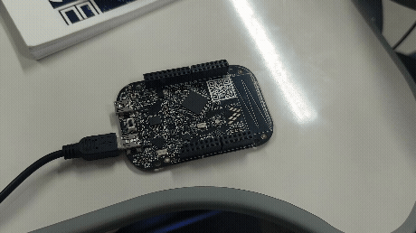

# Setup RTOS e LEDs Baremetal

## Configuração do LED
Como não há dois leds na placa, foi feito o código de maneira que cada cor apareça com um intervalo. Primeiro, o led vermelho pisca em intervalos de 1 segundo, depois o led verde pisca com intervalos de meio segundo.

 

** Para realizar o desafio, basta mudar a frequência do led verde para 350 ms
